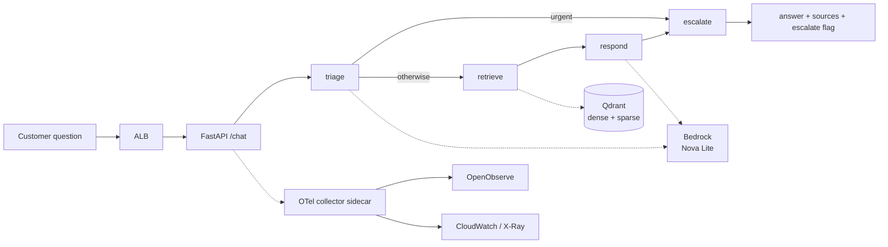

# support-agent

A retrieval-augmented support agent that answers customer questions from a
knowledge base, cites its sources, and hands off to a human when it cannot
answer well. Deployed on ECS Fargate in a private subnet, instrumented with
OpenTelemetry traces and CloudWatch EMF metrics.

Built as a four-week learning project. The companion observability stack lives
in [llm-observability-stack](https://github.com/Rahnair89/llm-observability-stack).

## How a request flows



Four nodes in a LangGraph state machine. `triage` classifies the message,
`retrieve` runs hybrid search, `respond` answers from the retrieved context,
and `escalate` decides whether a human is needed. An urgent classification
skips retrieval and routes straight to escalation.

## Design decisions

**Hybrid retrieval, not pure vector search.** Dense embeddings (Bedrock Titan
v2, 1024 dimensions) are fused with BM25 sparse vectors using reciprocal rank
fusion, then reranked with a cross-encoder. Support questions contain exact
strings — error codes, API names, `AccessDenied` — that embeddings alone match
poorly. BM25 catches those; the dense half catches paraphrase.

**Retrieval score as an escalation signal.** When the top reranked score falls
below a threshold, the agent escalates instead of answering. The knowledge base
has deliberate gaps (no pricing or contract articles) so this path is testable.

**Everything private.** The task runs in a private subnet and reaches Bedrock,
ECR, Secrets Manager and CloudWatch through VPC interface endpoints, and S3
through a gateway endpoint. Only the ALB is reachable, and only from a single
allowed CIDR.

**Prompt versions as config.** `PROMPT_VERSION` selects `prompts/<name>.<ver>.md`
with a fallback to `v1`, so two prompt versions can be run over the same
questions and compared.

See [`docs/adr/`](docs/adr/) for the recorded decisions and
[`docs/nfr.md`](docs/nfr.md) for the non-functional requirements.

## Known limitation

The escalation decision is derived from a substring match on the generated
answer. That makes a control-flow decision depend on model phrasing: a prompt
change that adds an "Escalate if…" section alters escalation behaviour without
touching the escalation logic. Measured on 10 questions, two prompt versions
produced different escalation counts in both directions for the same inputs.

The fix is to make routing a structured output — a machine-only final line, or
a separate escalation node returning a single token — so the decision is
independent of answer wording. Not yet implemented. Written up in
[`DAILY_LOG.md`](DAILY_LOG.md).

## Observability

Each request emits:

| Signal | Where | Contents |
|---|---|---|
| Trace | OpenObserve + CloudWatch | one span per graph node; `rag.chunks.retrieved`, `rag.top_score`, `prompt.version` |
| Metrics | CloudWatch via EMF | tokens, cost in USD, latency, chunks retrieved, escalation flag |
| Logs | CloudWatch Logs | application logs from the Fargate task |

Traces go to both OpenObserve and CloudWatch deliberately: in a customer's own
AWS account, telemetry that only lands in a vendor UI is telemetry their
on-call team cannot use.

Token costs are computed from `config/pricing.yaml`, which must match
`MODEL_ID`. Nothing validates that today — a mismatch produces a plausible but
wrong cost figure rather than an error.

## Running it locally

Requires Python 3.11, Docker, and AWS credentials with Bedrock access.

```bash
python -m venv .venv
source scripts/dev-shell.sh          # activates the venv, loads .env, checks SSO
pip install -r requirements.txt

docker run -d --rm --name qdrant -p 6333:6333 qdrant/qdrant:latest
python src/rag/ingest.py             # chunks and indexes kb/*.md

uvicorn app.main:app --reload --port 8000
```

```bash
curl -s -X POST localhost:8000/chat -H 'Content-Type: application/json' \
  -d '{"message":"How do I reset MFA for a user who lost their phone?"}' | python -m json.tool
```

Interactive API docs at <http://127.0.0.1:8000/docs>.

## Running it on AWS

`infra/` holds the Terraform. Set `my_ip_cidr` in `infra/terraform.tfvars` to
your own address — the ALB allows nothing else.

```bash
terraform -chdir=infra init
terraform -chdir=infra apply
./scripts/deploy.sh                  # builds linux/amd64, pushes to ECR, forces a new deployment
curl "http://$(terraform -chdir=infra output -raw alb_dns)/health"
```

Always use `-chdir` rather than `cd`. Run from the wrong directory and Terraform
finds an empty configuration, reports success, and changes nothing — which is
how a NAT gateway ends up billing after a `destroy` that said "0 destroyed".

Tear down with `terraform -chdir=infra destroy`, then verify against the API
rather than the command's own output:

```bash
aws ec2 describe-nat-gateways --filter Name=state,Values=available \
  --query 'NatGateways[].NatGatewayId' --output text
```

## Repository map

| Path | Contents |
|---|---|
| `src/app/` | FastAPI app, LangGraph flow, prompt loader, EMF metrics |
| `src/rag/` | ingestion, hybrid search, shared Qdrant and Bedrock clients |
| `prompts/` | versioned system prompts |
| `kb/` | 20 synthetic knowledge-base articles for a fictional product |
| `infra/` | Terraform: VPC, endpoints, ALB, ECS, IAM, collector config |
| `config/` | RAG parameters and model pricing |
| `docs/` | ADRs, non-functional requirements, failure table |
| `evals/` | evaluation question set |
| `DAILY_LOG.md` | daily build log: what was built, what broke, what it taught |

The knowledge base is invented. It describes a fictional cloud security
platform and contains deliberate gaps so that retrieval failure and escalation
can be exercised.

## What I would change next

1. Make escalation a structured decision rather than a substring match.
2. Validate `pricing.yaml` against `MODEL_ID` at startup and fail loudly.
3. Replace the Qdrant sidecar with a persistent store — today the index is
   rebuilt on every task start.
4. Add a precondition check to the evaluation harness so it cannot report a
   verdict when its inputs are empty.

## Build log

[`DAILY_LOG.md`](DAILY_LOG.md) records each day's work and every failure worth
keeping, including three cases where a component reported success while doing
nothing: a `terraform destroy` that destroyed nothing, a health check that
passed without touching its dependency, and a comparison harness that printed a
verdict from two empty files.
